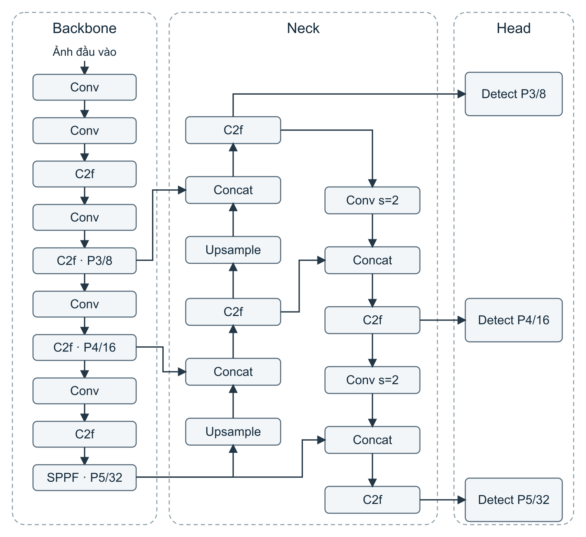
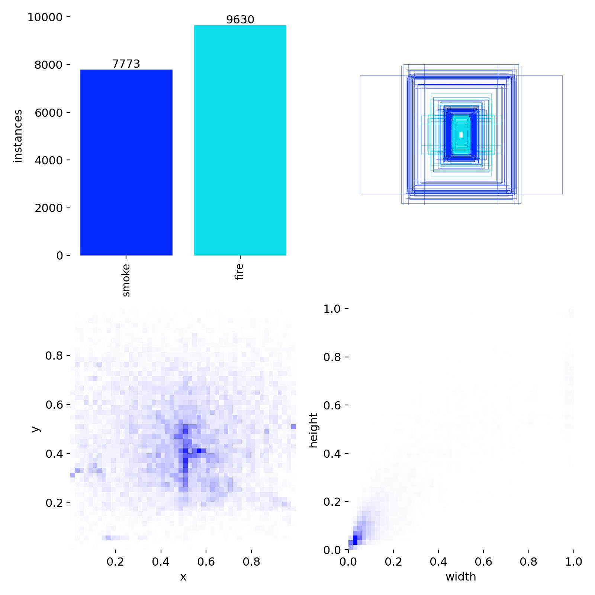
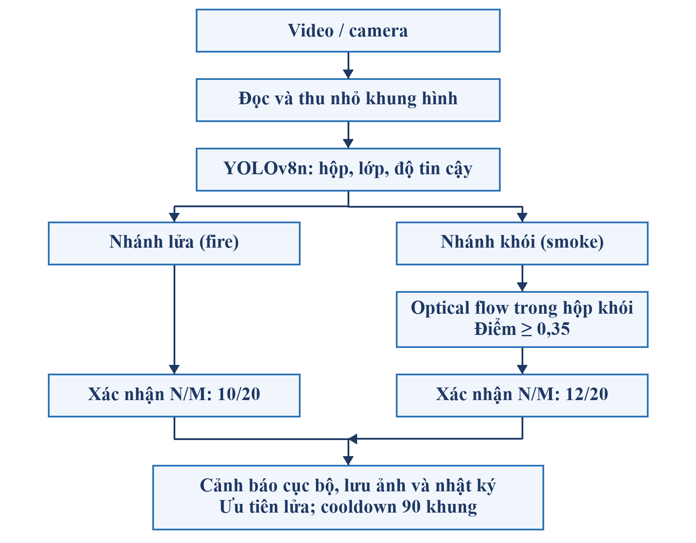
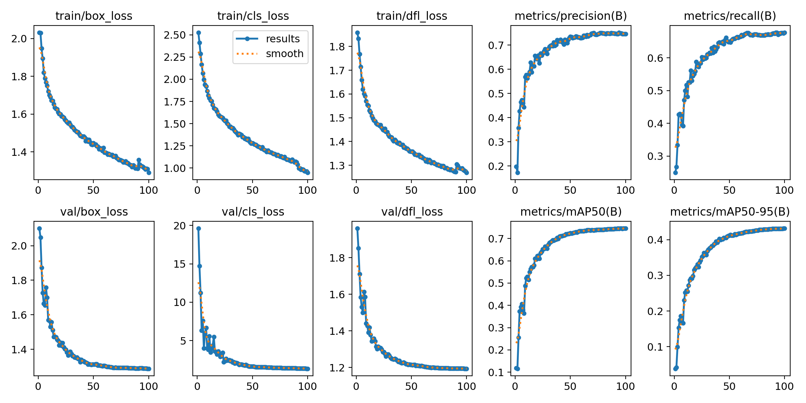
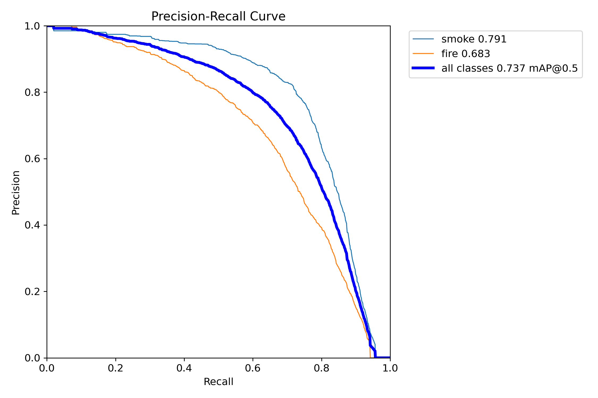
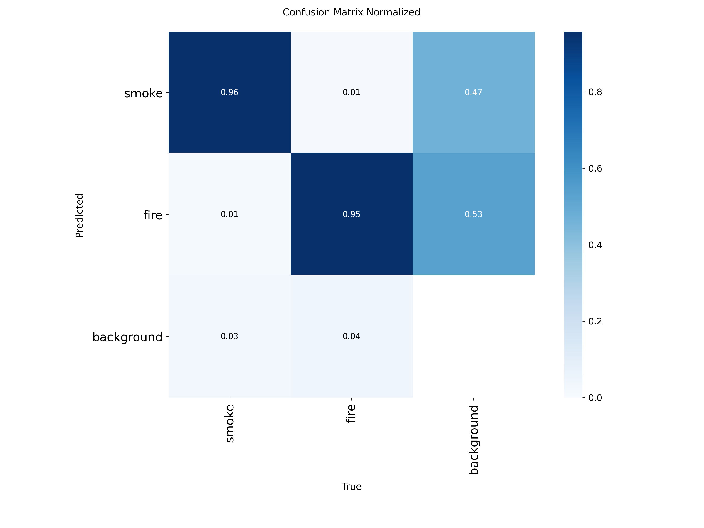
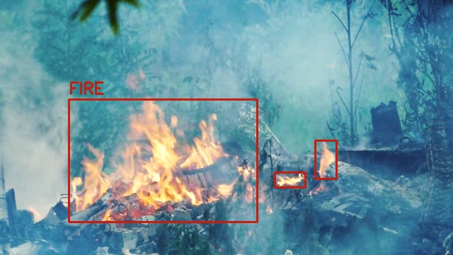
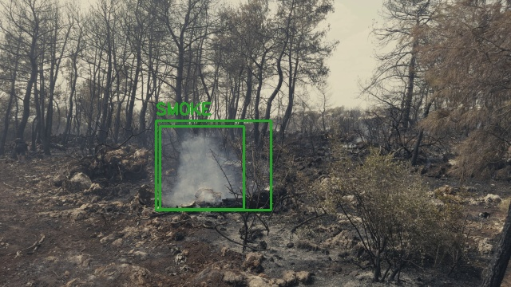

# Báo cáo Word chuyển sang Markdown

Nguồn: `report_revision/fix_review_20261027/output/smoke_fire_detection.docx`

Bản trích nội dung ngày 28/10/2026, giữ thứ tự đoạn, bảng và hình. Công thức được chuyển sang ký hiệu văn bản với dấu ngoặc thể hiện phân số. Số trang trong mục lục thuộc bản Word, không phải trang Markdown. Font, lề, ngắt trang và ô gộp không được tái hiện đầy đủ.

---

TRƯỜNG ĐẠI HỌC XÂY DỰNG HÀ NỘI KHOA CÔNG NGHỆ THÔNG TIN

BÁO CÁO ĐỒ ÁN THỊ GIÁC MÁY TÍNH

HỆ THỐNG PHÁT HIỆN CHÁY VÀ KHÓI

BẰNG MÔ HÌNH YOLOv8

(Fire and Smoke Detection System Using YOLOv8)

Sinh viên thực hiện:    Đinh Xuân Nam - 0211268

Giảng viên hướng dẫn:    Nguyễn Đình Quý

Ngành học:    Khoa học máy tính

Hà Nội, tháng 10 năm 2026

## TÓM TẮT

Đồ án xây dựng hệ thống phát hiện lửa và khói trong ảnh, video bằng mô hình YOLOv8n. Mô hình được tinh chỉnh từ trọng số có sẵn yolov8n.pt trên bộ Smoke-Fire-Detection-YOLO, với hai lớp smoke và fire. Lần huấn luyện chính thức hoàn thành 100 epoch trên một GPU Tesla T4 của Kaggle, sử dụng imgsz=640 và batch=16. Phần mềm xử lý video trên máy cá nhân và lưu cảnh báo tại máy.

Trên 4.291 ảnh test hợp lệ, mô hình đạt Precision 74,27%, Recall 67,45%, mAP50 73,70% và mAP50–95 41,63%. Kết quả mAP50 của smoke là 79,13% và fire là 68,27%. Các chỉ số này được lấy từ phép đánh giá best.pt trên tập test, tách biệt với số liệu validation trong quá trình huấn luyện.

Chương trình kết hợp YOLO với xác nhận theo cửa sổ N/M và điểm chuyển động khói tính từ optical flow Farneback. Thử nghiệm trên bốn video cho thấy có cảnh báo ở video lửa và video khói, không có cảnh báo ở hai video sạch với tổng thời lượng 25,33 giây. So sánh từ cùng đầu ra từng khung hình cho thấy bộ lọc chuyển động làm giảm số khung hình xác nhận khói; dữ liệu hiện có chưa chứng minh bộ lọc làm giảm báo nhầm so với YOLO đơn thuần.

Các số liệu video chỉ mô tả bốn clip đã chọn. Một phép chạy trên máy cá nhân dùng CPU đạt 4,32 khung/giây khi tính toàn bộ thời gian thực hiện lệnh. Chưa có mốc bắt đầu sự kiện để tính độ trễ và chưa đánh giá trên nhiều bối cảnh khác.

Từ khóa: YOLOv8n, phát hiện cháy và khói, học chuyển giao, N/M, optical flow, thị giác máy tính.

# Mục lục

TÓM TẮT    1

1  GIỚI THIỆU BÀI TOÁN    4

1.1  Bối cảnh và Động lực Nghiên cứu    4

1.2  Mục tiêu Đồ án    4

1.3  Phạm vi Thực hiện    5

1.4  Cấu trúc Báo cáo    5

2  CƠ SỞ LÝ THUYẾT    6

2.1  Tổng quan về Phát hiện Đối tượng    6

2.1.1  Bài toán phát hiện đối tượng    6

2.1.2  Kiến trúc YOLOv8    6

2.1.3  Các chỉ số đánh giá phát hiện đối tượng    7

2.2  Học chuyển giao và Trọng số mô hình    8

2.3  Xác nhận theo Cửa sổ N/M    8

2.4  Optical Flow và Điểm chuyển động khói    9

3  DỮ LIỆU    10

3.1  Tổng quan Dữ liệu Sử dụng    10

3.2  Dữ liệu Phát hiện Cháy và Khói    10

3.2.1  Nguồn dữ liệu    10

3.2.2  Cấu trúc dữ liệu    10

3.2.3  Phân tích phân phối dữ liệu    11

3.2.4  Tiền xử lý và Tăng cường dữ liệu    12

3.3  Video Kiểm thử Chương trình    13

3.3.1  Nguồn và mô tả video    13

3.3.2  Quy trình chuẩn bị đầu vào    13

4  PHƯƠNG PHÁP THỰC HIỆN    14

4.1  Kiến trúc Tổng thể Hệ thống    14

4.2  Mô-đun Phát hiện Cháy và Khói    14

4.2.1  Lựa chọn mô hình    14

4.2.2  Chiến lược huấn luyện    15

4.2.3  Đánh giá và Lưu mô hình    16

4.2.4  Ngưỡng suy luận    16

4.3  Hậu xử lý N/M và Optical Flow    16

4.3.1  Xác nhận lửa và khói    16

4.3.2  Kiểm tra chuyển động trong vùng khói    17

4.3.3  Kiểm tra bộ lọc bằng tín hiệu đã lưu    17

4.4  Tích hợp Pipeline và Hệ thống Cảnh báo    17

4.4.1  Luồng xử lý chính    17

4.4.2  Cảnh báo và Lưu trữ cục bộ    18

4.5  Tổ chức Mã nguồn và Chạy trên máy cá nhân    18

5  KẾT QUẢ THỰC NGHIỆM VÀ ĐÁNH GIÁ    19

5.1  Môi trường Thực nghiệm    19

5.2  Kết quả Mô-đun Phát hiện Cháy và Khói    19

5.2.1  Kết quả huấn luyện    19

5.2.2  Đánh giá trên tập Test    20

5.2.3  Quan sát định tính với hai trọng số    22

5.3  Kết quả Kiểm thử Video và Bộ lọc    22

5.3.1  Kết quả trên bốn video kiểm thử    22

5.3.2  So sánh ba Cấu hình xử lý    23

5.3.3  Kiểm tra điểm chuyển động    24

5.4  Hiệu năng và Những phép đo còn thiếu    24

5.5  Thảo luận Kết quả    25

5.5.1  Điểm mạnh    25

5.5.2  Điểm yếu và Hạn chế    25

5.5.3  So sánh với các Cách xử lý trong đồ án    26

6  KẾT LUẬN VÀ HƯỚNG PHÁT TRIỂN    27

6.1  Kết luận    27

6.2  Hướng Phát triển    27

Tài liệu tham khảo    28

A.  Tham số Cấu hình Chính    29

B.  Hướng dẫn Cài đặt và Chạy    30

## 1  GIỚI THIỆU BÀI TOÁN

### 1.1  Bối cảnh và Động lực Nghiên cứu

Phát hiện dấu hiệu cháy và khói từ hình ảnh là một bài toán ứng dụng của thị giác máy tính. Một hệ thống camera có thể quan sát vùng lửa hoặc khói trong trường nhìn và đưa ra thông báo để người vận hành kiểm tra. Khó khăn của bài toán nằm ở sự thay đổi màu sắc, kích thước và hình dạng của lửa, độ trong của khói, điều kiện chiếu sáng và các vật thể có biểu hiện tương tự.

Quan sát định tính với trọng số ban đầu cho thấy vùng đèn đường có thể bị nhận thành lửa và một số vùng lửa bị bỏ sót. Vì vậy, chất lượng mô hình cần được đánh giá trên tập test, thay vì kết luận từ một vài ảnh minh họa.

Đồ án dùng YOLOv8n và bộ dữ liệu công khai đã gán nhãn để huấn luyện mô hình nhận diện lửa, khói. Công việc gồm kiểm tra dữ liệu, huấn luyện lại, đánh giá trên tập test, viết chương trình đọc video và kiểm tra bộ lọc cảnh báo. Đồ án không đề xuất kiến trúc mạng nơ-ron mới.

| Vấn đề đặt ra |
| --- |
| Làm thế nào để xác định vùng lửa và khói trong ảnh hoặc video, giảm cảnh báo từ tín hiệu xuất hiện ngắn và lưu kết quả để kiểm tra lại? Hệ thống hỗ trợ quan sát; người dùng cần kiểm tra cảnh báo trước khi xử lý. |

### 1.2  Mục tiêu Đồ án

•  Tinh chỉnh YOLOv8n từ trọng số tiền huấn luyện để phát hiện hai lớp smoke và fire; lưu cấu hình và kết quả của lần huấn luyện chính thức.

•  Đánh giá best.pt bằng Precision, Recall, mAP50 và mAP50–95 trên tập test; phân tích kết quả theo từng lớp.

•  Tích hợp mô hình vào chương trình đọc video, vẽ khung nhận diện và tên lớp, xác nhận N/M, kiểm tra chuyển động khói, lưu ảnh cảnh báo, video và nhật ký trên máy.

•  So sánh YOLO đơn thuần, YOLO + N/M và YOLO + N/M + optical flow trên cùng bốn video kiểm thử; phân biệt số lần báo với số sự kiện được gộp.

### 1.3  Phạm vi Thực hiện

YOLO dự đoán hộp giới hạn, tên lớp và điểm tin cậy cho fire, smoke trong ảnh màu. Trên video, kết quả được biểu diễn bằng hộp giới hạn và tên lớp. Chương trình không phân đoạn từng điểm ảnh, đo nhiệt độ hoặc xác định nguyên nhân cháy.

Huấn luyện và đánh giá mô hình được thực hiện trên Kaggle. Kiểm thử chương trình chính được thực hiện trên máy cá nhân, dùng bốn video đã có. Mã nguồn có tùy chọn camera, nhưng lần kiểm thử được báo cáo là xử lý tệp video; chưa dùng kết quả đó để khẳng định vận hành camera liên tục hoặc thời gian thực trên một thiết bị cụ thể.

Mã chương trình có sẵn được điều chỉnh cho bài toán hai lớp fire và smoke. Kết quả huấn luyện, đánh giá và hình minh họa trong chương 5 sử dụng mô hình YOLOv8n của lần huấn luyện này, trừ phần đối chiếu định tính được ghi riêng.

### 1.4  Cấu trúc Báo cáo

•  Chương 1: Giới thiệu bối cảnh, mục tiêu và phạm vi bài toán.

•  Chương 2: Cơ sở lý thuyết về phát hiện đối tượng, YOLOv8, học chuyển giao, N/M và optical flow.

•  Chương 3: Nguồn dữ liệu, định dạng nhãn, thống kê, tiền xử lý và video kiểm thử.

•  Chương 4: Kiến trúc xử lý, huấn luyện mô hình, hậu xử lý và chương trình cảnh báo.

•  Chương 5: Kết quả huấn luyện, đánh giá test, thử nghiệm video và thảo luận giới hạn.

•  Chương 6: Kết luận và hướng phát triển.

## 2  CƠ SỞ LÝ THUYẾT

### 2.1  Tổng quan về Phát hiện Đối tượng

#### 2.1.1  Bài toán phát hiện đối tượng

Phát hiện đối tượng kết hợp phân loại và định vị. Với mỗi đối tượng dự đoán, mô hình trả về nhãn lớp, điểm tin cậy và hộp giới hạn. Trong đồ án, một ảnh có thể chứa nhiều vùng lửa, nhiều vùng khói, đồng thời cả hai lớp hoặc không có đối tượng nào.

YOLO thuộc nhóm mô hình phát hiện một giai đoạn: các dự đoán vị trí và lớp được tạo trong một lượt xử lý của mạng. Sau đó, dự đoán được lọc bằng ngưỡng tin cậy và cơ chế loại các hộp chồng lặp. Điểm tin cậy của một hộp không đồng nghĩa với độ chính xác tổng thể của mô hình [1].

#### 2.1.2  Kiến trúc YOLOv8

YOLOv8 do Ultralytics phát triển, dùng đầu phát hiện không dựa vào các hộp neo được định nghĩa trước. Ở mức khái quát, mạng gồm backbone trích xuất đặc trưng, neck kết hợp đặc trưng nhiều tỷ lệ và head dự đoán lớp cùng vị trí đối tượng [1].

Đồ án dùng YOLOv8n, biến thể nano của YOLOv8. Mô hình khởi tạo từ yolov8n.pt rồi được tinh chỉnh cho hai nhãn smoke và fire. Log đánh giá ghi 3.132.950 tham số và 8,6 GFLOPs; các số này mô tả quy mô mô hình, chưa cho biết tốc độ xử lý video trên máy cá nhân [7].



Hình 2.1: Kiến trúc tổng quan YOLOv8 gồm backbone, neck và head [1].

#### 2.1.3  Các chỉ số đánh giá phát hiện đối tượng

Một dự đoán đúng cần thỏa mãn tiêu chí lớp và mức giao nhau giữa hộp dự đoán với hộp nhãn. IoU là tỷ số diện tích giao trên diện tích hợp của hai hộp. TP là dự đoán đúng; FP là dự đoán không ghép đúng với nhãn; FN là đối tượng có nhãn nhưng bị bỏ sót.

`Precision = (TP)/(TP + FP)`    (2.1)

`Recall = (TP)/(TP + FN)`    (2.2)

`F1 = (2 × Precision × Recall)/(Precision + Recall)`    (2.3)

Precision thể hiện mức đúng trong các dự đoán dương, còn Recall thể hiện mức phát hiện được trong số đối tượng thực tế. Khi thay đổi ngưỡng tin cậy, hai chỉ số có thể thay đổi theo hướng đánh đổi: giảm ngưỡng giữ lại nhiều dự đoán hơn nhưng cũng có thể tăng dự đoán sai.

AP tổng hợp đường cong Precision–Recall của từng lớp. mAP50 là trung bình AP các lớp ở ngưỡng IoU 0,50; mAP50–95 còn lấy trung bình qua các ngưỡng IoU từ 0,50 đến 0,95, bước 0,05. Báo cáo trình bày kết quả do bộ đánh giá Ultralytics trả về; không diễn giải mAP là tỷ lệ ảnh dự đoán đúng [3].

### 2.2  Học chuyển giao và Trọng số mô hình

Trọng số là các tham số số học mà mạng học được từ dữ liệu. Tệp .pt lưu trạng thái mô hình theo định dạng PyTorch; cần nạp bằng thư viện phù hợp để kiểm tra kiến trúc, nhãn lớp và thực hiện suy luận. Đổi tên tệp hoặc đổi tên lớp trong mã nguồn không thay thế cho quá trình huấn luyện.

Học chuyển giao sử dụng trọng số đã học làm điểm khởi tạo, sau đó cập nhật theo dữ liệu của bài toán mới. Đồ án dùng yolov8n.pt làm khởi tạo và tinh chỉnh trên dữ liệu có nhãn fire/smoke. Quá trình này khác với tự thiết kế một mạng mới: kiến trúc nền được kế thừa, còn trọng số được cập nhật cho dữ liệu mục tiêu [2].

Tập train dùng để cập nhật trọng số; tập validation hỗ trợ theo dõi và chọn checkpoint; tập test được dùng cho phép đánh giá sau huấn luyện. best.pt là checkpoint được bộ huấn luyện chọn theo tiêu chí đánh giá, còn last.pt là trạng thái cuối lần chạy. Hai tệp cần được lưu cùng args.yaml và results.csv để truy xuất nguồn gốc.

### 2.3  Xác nhận theo Cửa sổ N/M

Tín hiệu nhận diện có thể dao động giữa các khung hình. Cơ chế N/M lưu tối đa M tín hiệu nhị phân gần nhất và xác nhận khi có ít nhất N tín hiệu dương. Mã nguồn dùng deque có giới hạn kích thước; khi thêm khung hình mới, phần tử cũ nhất tự rời khỏi cửa sổ [8].

`confirmed ⇔ sum(window) ≥ N`    (2.4)

Cấu hình hiện tại đặt M = 20, N_fire = 10 và N_smoke = 12.

N/M không yêu cầu N khung dương liên tiếp. Ví dụ, trong 20 khung gần nhất có 12 khung nhận diện khói hợp lệ thì đạt ngưỡng khói, dù có các khung âm xen giữa. Ở đầu video, chương trình có thể xác nhận ngay khi tích lũy đủ N tín hiệu, không bắt buộc chờ đủ M khung.

Cửa sổ được duy trì riêng theo lớp nhưng xét trên toàn khung hình, chưa gắn với ID từng vùng. Vì vậy, các vùng khác nhau ở những thời điểm gần nhau có thể cùng góp tín hiệu vào một cửa sổ. Tỷ lệ tín hiệu dương fire_ratio và smoke_ratio được lưu trong frames.jsonl để phân tích; video không hiển thị chúng và chúng không phải xác suất của YOLO.

### 2.4  Optical Flow và Điểm chuyển động khói

Optical flow mô tả chuyển động biểu kiến giữa hai khung hình liên tiếp. Phương pháp Farneback trong OpenCV ước lượng trường chuyển động dày đặc, tức một vector chuyển động tại các vị trí ảnh. Chuyển động quan sát được có thể đến từ vật thể hoặc camera; vì vậy optical flow tự nó không phải bộ nhận diện khói [4].

Trong chương trình, hai khung hình được đổi sang ảnh xám để tính flow. Với mỗi hộp khói do YOLO dự đoán, vùng tương ứng được dùng để tính điểm S từ độ lớn chuyển động, độ phân tán hướng và xu hướng đi lên. Các thành phần được kết hợp theo công thức cài đặt trong MotionAnalyzer [8].

`S = 0,35m + 0,45H + 0,20u`    (2.5)

Trong đó m là điểm độ lớn chuyển động, H là entropy hướng đã chuẩn hóa và u là điểm xu hướng đi lên. Điểm u được tính bằng tỷ số giữa âm của chuyển động dọc trung bình và độ lớn chuyển động trung bình trên các pixel đang chuyển động, rồi chặn trong [0, 1]. Một khung có khói hợp lệ khi ít nhất một hộp smoke có S ≥ 0,35.

Độ lớn trung bình toàn vùng được chia cho 4 và chặn trên ở 1. Pixel có độ lớn lớn hơn 0,3 pixel/khung được xem là đang chuyển động. Nếu tỷ lệ pixel chuyển động dưới 10%, điểm bằng 0; nếu đủ, entropy hướng được tính trên 8 khoảng hướng với trọng số theo độ lớn chuyển động, và thành phần đi lên được tính trên các pixel chuyển động.

Ở khung đầu chưa có cặp ảnh để tính flow, hàm trả về mặc định 0,5; đây không phải bằng chứng chuyển động thực. Sau khi kiểm tra điểm, tín hiệu khói hợp lệ mới đi vào cửa sổ N/M. Cách tính này là quy tắc hậu xử lý của chương trình, không phải điểm tin cậy được YOLO học. Khói mỏng, chậm hoặc cảnh camera thay đổi có thể làm quy tắc hoạt động chưa phù hợp.

## 3  DỮ LIỆU

### 3.1  Tổng quan Dữ liệu Sử dụng

Đồ án sử dụng bộ Smoke-Fire-Detection-YOLO do tài khoản sayedgamal99 cung cấp trên Kaggle [5]. Bộ dữ liệu có sẵn ảnh và nhãn hộp giới hạn, được chia thành train, val và test. Đồ án giữ cách chia này, điều chỉnh đường dẫn cấu hình cho môi trường Kaggle và kiểm tra một số mẫu trước khi huấn luyện. Nhãn có sẵn không phải do đồ án tự gán lại.

Ngoài dữ liệu ảnh để huấn luyện và test, đồ án dùng bốn video riêng cho thử nghiệm chương trình. Các video này phục vụ minh họa và kiểm tra luồng cảnh báo, không thay thế tập test có nhãn hộp giới hạn.

### 3.2  Dữ liệu Phát hiện Cháy và Khói

#### 3.2.1  Nguồn dữ liệu

Đường dẫn dữ liệu trong lần chạy Kaggle là /kaggle/input/datasets/sayedgamal99/smoke-fire-detection-yolo. Tệp YAML gốc trỏ đến một thư mục làm việc không tồn tại trong phiên mới, nên bản cấu hình sử dụng được lưu riêng tại /kaggle/working/fire_smoke_data.yaml. Việc sửa path chỉ giúp bộ nạp tìm đúng ảnh và nhãn, không thay đổi nội dung nhãn.

#### 3.2.2  Cấu trúc dữ liệu

```text
data/
  train/images/    train/labels/
  val/images/      val/labels/
  test/images/     test/labels/

0: smoke
1: fire
```

Listing 3.1: Tổ chức dữ liệu và ánh xạ lớp cho YOLOv8n.

Mỗi ảnh đi kèm một tệp .txt có cùng tên gốc. Một dòng nhãn gồm class_id, x_center, y_center, width, height; bốn giá trị tọa độ được chuẩn hóa theo kích thước ảnh [6]. Ví dụ AoF00001.txt có dòng “1 0.216228 0.739130 0.136899 0.150502”, nghĩa là hộp thuộc lớp fire, không phải smoke.

Ảnh nền không có lửa hoặc khói là ví dụ âm hữu ích. Một ảnh có thể chứa nhiều hộp cùng lớp hoặc cả hai lớp; do đó số đối tượng và số ảnh chứa đối tượng không bằng nhau. Theo data.yaml và model.names, nhãn 0 là smoke, nhãn 1 là fire.

Bảng 3.1: Số lượng ảnh được nạp ở ba tập dữ liệu [7].

| Tập | Số tệp ảnh | Bị bỏ qua | Ảnh được dùng |
| --- | --- | --- | --- |
| Train | 14.122 | 21 | 14.101 |
| Validation | 3.099 | 5 | 3.094 |
| Test | 4.306 | 15 | 4.291 |
| Tổng | 21.527 | 41 | 21.486 |

Các mẫu bị bỏ qua không đồng nghĩa toàn bộ đều là ảnh hỏng về nội dung. Log có trường hợp thao tác sửa ảnh thất bại vì /kaggle/input chỉ đọc. Riêng test có 4 mẫu nhãn tọa độ ngoài miền hợp lệ và 11 mẫu bị loại với lỗi đọc/ghi trong thư mục chỉ đọc. Kết quả test ở chương 5 áp dụng cho 4.291 ảnh thực sự được bộ đánh giá sử dụng.

#### 3.2.3  Phân tích phân phối dữ liệu

Biểu đồ labels.jpg của lần train ghi nhận 7.773 hộp smoke và 9.630 hộp fire. Đây là số đối tượng trong dữ liệu huấn luyện được nạp, không phải số ảnh. Một số hộp có kích thước nhỏ so với ảnh, tạo khó khăn khi thu nhỏ ảnh trước suy luận.



Hình 3.1: Phân bố nhãn và hộp giới hạn trong dữ liệu huấn luyện YOLOv8n.

Trong tập test hợp lệ có 2.298 đối tượng smoke và 2.868 đối tượng fire. Số ảnh chứa smoke là 2.066, chứa fire là 1.111; các nhóm ảnh có thể chồng nhau. Chưa rà trùng giữa train/val/test theo ảnh hoặc theo nguồn video, nên chưa thể kết luận mức độ độc lập của các nguồn ảnh.

#### 3.2.4  Tiền xử lý và Tăng cường dữ liệu

Kích thước huấn luyện đặt imgsz=640. Bộ nạp của Ultralytics thực hiện biến đổi ảnh và chuẩn hóa phù hợp với mô hình. Các tham số tăng cường dữ liệu được lấy từ args.yaml của lần chạy chính thức, không dùng lại cấu hình của notebook cũ [2, 7].

Bảng 3.2: Các tham số tăng cường dữ liệu chính trong args.yaml.

| Tham số | Giá trị | Ý nghĩa |
| --- | --- | --- |
| mosaic / close_mosaic | 1,0 / 10 | Ghép ảnh; tắt ở 10 epoch cuối |
| hsv_h / hsv_s / hsv_v | 0,015 / 0,7 / 0,4 | Biến đổi màu, bão hòa, độ sáng |
| translate / scale | 0,1 / 0,5 | Dịch chuyển và thay đổi tỷ lệ |
| fliplr / flipud | 0,5 / 0,0 | Lật ngang; không lật dọc |
| degrees / shear | 0,0 / 0,0 | Không xoay/nghiêng theo hai tham số này |
| mixup / copy_paste | 0,0 / 0,0 | Không dùng hai phép tăng cường này |

Giữ nguyên cách chia tập và chỉ tăng cường dữ liệu train. Cần kiểm tra trực quan vị trí hộp và class_id; không dùng test để cập nhật trọng số.

### 3.3  Video Kiểm thử Chương trình

#### 3.3.1  Nguồn và mô tả video

Nguồn bốn video theo thứ tự Bảng 3.3: [Pexels 4743951](<https://www.pexels.com/vi-vn/video/cay-ng-n-l-a-nong-b-c-chuy-n-d-ng-4743951/>); [Pexels 26629191](<https://www.pexels.com/vi-vn/video/khi-h-u-phong-c-nh-thien-nhien-than-cay-26629191/>); [Pixabay 11496](<https://pixabay.com/vi/videos/c%C3%A1nh-%C4%91%E1%BB%93ng-hoa-h%C6%B0%E1%BB%9Bng-d%C6%B0%C6%A1ng-ho%C3%A0ng-h%C3%B4n-11496/>); [Pexels 35010963](<https://www.pexels.com/vi-vn/download/video/35010963/>). Giấy phép: [Pexels License](<https://www.pexels.com/license/>) và [Pixabay Content License](<https://pixabay.com/service/license-summary/>).

Bảng 3.3: Bốn video dùng để kiểm thử chương trình.

| Video | Nội dung | Số khung | Thời lượng |
| --- | --- | --- | --- |
| video_chay | Lửa đốt đống gỗ | 643 | 21,45 s |
| video_khoi | Khói mỏng ngoài trời | 534 | 17,80 s |
| video_khong_chay | Hoàng hôn, mây và hoa | 904 | 15,07 s |
| video_khong_chay2 | Đèn đường ban đêm | 308 | 10,27 s |

#### 3.3.2  Quy trình chuẩn bị đầu vào

Video nguồn từ 1280×720 đến 4K, khoảng 29,97; 30 hoặc 60 FPS. Tham số --max_side 640 thu nhỏ cạnh dài còn 640 pixel trước cả YOLO và optical flow, giữ tỷ lệ và làm tròn kích thước chẵn. Chương trình xử lý mọi khung hình.

imgsz=640 là kích thước đầu vào YOLO, khác với --max_side. Bảng so sánh bộ lọc sử dụng cùng đầu ra của lần chạy này để giữ điều kiện tiền xử lý đồng nhất.

## 4  PHƯƠNG PHÁP THỰC HIỆN

### 4.1  Kiến trúc Tổng thể Hệ thống

Quá trình thực hiện gồm hai giai đoạn: huấn luyện/đánh giá mô hình trên Kaggle và tích hợp trọng số vào chương trình cục bộ. Sản phẩm của huấn luyện là checkpoint cùng cấu hình, log và biểu đồ. Chương trình cục bộ nạp checkpoint, đọc từng khung hình, suy luận và áp dụng các quy tắc cảnh báo.



Hình 4.1: Luồng xử lý phát hiện lửa và khói; optical flow áp dụng cho vùng khói.

Nhánh lửa được xác nhận trực tiếp qua N/M. Nhánh khói cần ít nhất một hộp vượt ngưỡng chuyển động rồi mới đưa tín hiệu dương vào cửa sổ khói. Việc vẽ hộp nhận diện vẫn dựa trên dự đoán YOLO, nên có thể thấy hộp smoke trên màn hình dù bộ lọc chưa xác nhận cảnh báo.

### 4.2  Mô-đun Phát hiện Cháy và Khói

#### 4.2.1  Lựa chọn mô hình

YOLOv8n được chọn làm mô hình nền cho đồ án. Model được khởi tạo từ yolov8n.pt và tinh chỉnh với nc=2; nhãn 0 là smoke, nhãn 1 là fire. Việc dùng phiên bản nano giúp giới hạn quy mô mô hình, nhưng báo cáo không suy ra hiệu năng thời gian thực chỉ từ tên hoặc số tham số.

Chương trình sử dụng Models/fire_smoke_v2_best.pt, tương ứng với checkpoint best.pt của lần huấn luyện chính thức. Các kết quả test và video trong báo cáo được tạo bằng trọng số này. Trọng số ban đầu fire_best.pt không được dùng để tính các chỉ số của mô hình đã huấn luyện.

#### 4.2.2  Chiến lược huấn luyện

Bảng 4.1: Cấu hình huấn luyện YOLOv8n.

| Tham số | Giá trị | Ghi chú |
| --- | --- | --- |
| Mô hình khởi tạo | yolov8n.pt | Tiền huấn luyện, tinh chỉnh hai lớp |
| epochs / fraction | 100 / 1,0 | 100 epoch trên toàn bộ phần train hợp lệ |
| imgsz / batch | 640 / 16 | Khớp cấu hình đã lưu |
| optimizer / lr0 | AdamW / 0,01 | Không dùng cấu hình optimizer cũ |
| weight_decay | 0,0005 | Giá trị trong args.yaml |
| patience / warmup | 20 / 3 epoch | Early stopping và warmup |
| seed / workers | 42 / 2 | deterministic=True |
| device / amp | 0 / True | Một GPU Tesla T4; mixed precision |

Lần huấn luyện chính thức sử dụng toàn bộ tập train (fraction=1,0), hoàn thành 100 epoch trong 3,969 giờ theo nhật ký. Cấu hình, checkpoint và biểu đồ được lưu cùng kết quả của lần huấn luyện này.

Nhật ký results.csv ghi đủ 100 epoch, gồm các giá trị loss và chỉ số validation. Checkpoint best.pt được dùng để đánh giá tập test và suy luận; last.pt lưu trạng thái cuối của quá trình huấn luyện.

#### 4.2.3  Đánh giá và Lưu mô hình

```text
model = YOLO(".../train_official_v2/weights/best.pt")
metrics = model.val(
    data="/kaggle/working/fire_smoke_data.yaml",
    split="test", imgsz=640, device=0, plots=True
)
```

Listing 4.1: Lời gọi đánh giá tập test; đường dẫn checkpoint được lược bớt.

Đánh giá test sinh các đường cong Precision–Recall, Precision/Recall/F1 theo confidence và confusion matrix. Thư mục kết quả tên runs/detect/val vẫn được tạo khi gọi split="test"; tên thư mục không đủ để kết luận đây là tập validation. Báo cáo căn cứ vào lời gọi và bảng log 4.291 ảnh test [7].

Mô hình triển khai trong báo cáo dùng checkpoint PyTorch .pt. Chưa có kết quả benchmark sau xuất ONNX hoặc TensorRT cho mô hình mới; do đó không mô tả chuyển đổi hay tăng tốc trên thiết bị biên là công việc đã hoàn thành.

#### 4.2.4  Ngưỡng suy luận

Chương trình kiểm thử video dùng conf=0,25 và imgsz=640. Giảm ngưỡng confidence có thể giữ thêm hộp dự đoán nhưng cũng có thể tăng nhận nhầm. Ngưỡng 0,25 chưa được chọn bằng một nghiên cứu tối ưu ngưỡng riêng.

Ngưỡng confidence 0,25 của chương trình video khác cách Ultralytics tổng hợp Precision và Recall khi đánh giá tập test. Vì vậy không dùng các chỉ số test để suy ra hiệu quả tại riêng ngưỡng vận hành này; phép so sánh đó cần một lần đánh giá với ngưỡng cố định.

### 4.3  Hậu xử lý N/M và Optical Flow

#### 4.3.1  Xác nhận lửa và khói

SlidingWindowConfirm được khởi tạo riêng cho hai lớp, cùng M=20. Lửa dùng N=10; khói dùng N=12. Mỗi khung hình cập nhật một tín hiệu theo lớp, không tăng nhiều lần chỉ vì trong một khung có nhiều hộp. Các cửa sổ được đặt lại khi bắt đầu video mới.

```text
self._buf.append(1 if detected else 0)
return sum(self._buf) >= self.N
```

Listing 4.2: Logic xác nhận trong SlidingWindowConfirm.update().

#### 4.3.2  Kiểm tra chuyển động trong vùng khói

MotionAnalyzer gọi calcOpticalFlowFarneback trên toàn khung hình xám với pyr_scale=0,5; levels=3; winsize=15; iterations=3; poly_n=5 và poly_sigma=1,2. Sau đó từng hộp smoke được lấy làm vùng quan tâm để tính điểm chuyển động. Khi có ít nhất một hộp đạt 0,35, khung hình được ghi nhận là khói hợp lệ [8].

show_optical_flow=False chỉ ẩn mũi tên flow khi hiển thị; bộ lọc vẫn hoạt động. Để tìm hiểu ảnh hưởng của bộ lọc, chương trình lưu smoke_motion_scores và smoke_motion_pass cho từng khung hình, cùng trạng thái xác nhận sau N/M. Các trường này cho phép đối chiếu nguyên nhân cảnh báo hoặc không cảnh báo.

#### 4.3.3  Kiểm tra bộ lọc bằng tín hiệu đã lưu

Một phép kiểm tra tĩnh lặp lại cùng khung hình đèn đường cho 12 cặp khung sau khung đầu, cho điểm chuyển động 0 ở cả 12 lần. Đây là kiểm tra đối chứng tĩnh nhân tạo, không phải phép đo tỷ lệ báo giả trên video thực.

Với video khói, điểm chuyển động thực tế thay đổi theo từng hộp và thời gian. Nhận định về tác dụng của bộ lọc phải dựa vào so sánh các cách xử lý ở chương 5; việc hàm trả về 0 trên ảnh tĩnh không đủ chứng minh mọi vùng chuyển động có điểm cao đều là khói.

### 4.4  Tích hợp Pipeline và Hệ thống Cảnh báo

#### 4.4.1  Luồng xử lý chính

main.py đọc cấu hình, mở video bằng OpenCV và tạo FireSmokePipeline. Mỗi khung hình có thể được thu nhỏ theo --max_side trước khi đưa vào process(). Pipeline nạp YOLO, đọc model.names để phân loại fire hoặc smoke, tính flow, cập nhật N/M và lưu cảnh báo. Trên video, chương trình vẽ các hộp nhưng chỉ ghi một tên cho mỗi lớp đang được phát hiện: FIRE hoặc SMOKE. Điểm tin cậy, điểm chuyển động, FPS và số khung không che lên hình.

Khi lưu kết quả, chương trình ghi frames.jsonl cho từng khung hình, summary.json cho thông tin nguồn và thống kê, ảnh tại thời điểm cảnh báo, alerts.log và annotated.mp4 nếu có --save_video. Video xuất giữ FPS của nguồn và không có âm thanh. Đường dẫn weight/output tương đối được giải theo vị trí config.yaml.

#### 4.4.2  Cảnh báo và Lưu trữ cục bộ

AlertSystem lưu ảnh và ghi log cảnh báo trên máy. Video không có dải cảnh báo; trạng thái cảnh báo vẫn được tính để lưu kết quả và đếm sự kiện. Khi hai lớp cùng đủ điều kiện, lửa được ưu tiên; hai lớp dùng chung cooldown 90 khung hình. Vì vậy, video lửa có thể chứa hộp khói dù số cảnh báo khói bằng 0.

Cooldown được đếm theo khung hình đã xử lý. 90 khung tương ứng 3 giây theo thời gian video 30 FPS hoặc 1,5 giây ở 60 FPS. Thời gian xử lý thực tế trên máy có thể khác thời gian của video.

Chế độ --eval chỉ dùng cho video đã xác định không có lửa, khói; khi đó mỗi cảnh báo được tính là báo giả trong clip. EventCounter gộp các lần báo cách nhau không quá 60 giây thành một sự kiện. Mốc thời gian lấy từ chỉ số khung hình chia cho FPS của video; báo cáo ghi cả số lần cảnh báo và số sự kiện.

### 4.5  Tổ chức Mã nguồn và Chạy trên máy cá nhân

Bảng 4.2: Các thành phần của hệ thống phát hiện lửa và khói.

| Tệp | Vai trò |
| --- | --- |
| fire_detection/main.py | Đọc video, tham số dòng lệnh, lưu kết quả và thống kê sự kiện |
| fire_detection/pipeline.py | YOLO, optical flow, N/M, vẽ kết quả và cảnh báo |
| fire_detection/config.yaml | Weight, ngưỡng, cửa sổ xác nhận và thư mục kết quả |
| fire_detection/compare_saved_runs.py | Tính lại ba chế độ từ cùng nhật ký khung hình |
| Models/fire_smoke_v2_best.pt | Trọng số YOLOv8n mới được sử dụng |

## 5  KẾT QUẢ THỰC NGHIỆM VÀ ĐÁNH GIÁ

### 5.1  Môi trường Thực nghiệm

Bảng 5.1: Môi trường huấn luyện, đánh giá và kiểm thử video.

| Thông số | Huấn luyện và test | Chạy video cục bộ |
| --- | --- | --- |
| Nền tảng | Kaggle | Máy cá nhân Windows |
| Thiết bị tính toán | Tesla T4, CUDA:0 | CPU theo log pipeline |
| Python | 3.13.15 | 3.13.12 (.venv) |
| Ultralytics | 8.4.184 | 8.4.183 |
| PyTorch | 2.11.0+cu128 | 2.11.0+cpu |
| imgsz / tiền xử lý | 640 | 640; cạnh dài khung hình 640 |
| Phạm vi kết quả | Train 100 epoch; test ảnh | Bốn video, xử lý đủ khung hình |

Kết quả huấn luyện, test ảnh và thử nghiệm video được tách riêng vì có đơn vị đo khác nhau. Các chỉ số Precision/Recall/mAP dựa trên nhãn hộp giới hạn; kết quả video dưới đây là số khung hình kích hoạt điều kiện và số cảnh báo, chưa phải các chỉ số đánh giá đối tượng trên video.

### 5.2  Kết quả Mô-đun Phát hiện Cháy và Khói

#### 5.2.1  Kết quả huấn luyện

Lần chạy train_official_v2 hoàn thành 100 epoch. results.csv ghi mAP50 validation ở epoch 100 là 0,74537 và mAP50–95 là 0,43165; đây cũng là giá trị mAP50–95 lớn nhất trong 100 dòng đã lưu. Thời gian huấn luyện theo log là 3,969 giờ. Không dùng các số validation này thay cho kết quả test.



Hình 5.1: Loss và chỉ số validation của YOLOv8n qua 100 epoch.

Trong đồ thị huấn luyện, loss giảm so với đầu quá trình và mAP validation tăng rồi thay đổi chậm về cuối. Đây là kết quả trên tập validation dùng trong quá trình train. Kết quả của checkpoint trên tập test được báo cáo riêng ở mục 5.2.

#### 5.2.2  Đánh giá trên tập Test

Notebook đánh giá best.pt bằng split="test", imgsz=640 trên GPU 0. Bảng kết quả ghi 4.291 ảnh và 5.166 đối tượng. Các giá trị sau làm tròn đến bốn chữ số thập phân; dòng trung bình là kết quả tổng hợp do Ultralytics trả về [7].

Bảng 5.2: Kết quả của YOLOv8n trên 4.291 ảnh test hợp lệ.

| Lớp | Precision | Recall | mAP50 | mAP50–95 |
| --- | --- | --- | --- | --- |
| smoke | 0,7898 | 0,7308 | 0,7913 | 0,4761 |
| fire | 0,6956 | 0,6182 | 0,6827 | 0,3566 |
| Trung bình | 0,7427 | 0,6745 | 0,7370 | 0,4163 |

Lớp smoke có AP50 cao hơn fire trong phép đánh giá này. Chênh lệch đó là quan sát trên tập test hiện tại; chưa đủ căn cứ quy toàn bộ nguyên nhân cho màu sắc, mất cân bằng lớp hoặc đặc điểm của khói. Recall fire khoảng 0,6182 cho thấy vẫn có đối tượng lửa bị bỏ sót theo tiêu chí đánh giá.



Hình 5.2: Đường Precision–Recall của YOLOv8n trên tập test.



Hình 5.3: Confusion matrix chuẩn hóa trên tập test; trục ngang là nhãn thật, trục dọc là dự đoán.

Trong confusion matrix, các ô liên quan background biểu diễn dự đoán không ghép được với đối tượng hoặc đối tượng bị bỏ sót theo quy tắc đánh giá. Hình cần được đọc cùng cấu hình đánh giá; không lấy trực tiếp một ô đường chéo làm mAP hay độ chính xác toàn hệ thống.

#### 5.2.3  Quan sát định tính với hai trọng số

Trong ảnh KHOI2, trọng số ban đầu nhận nhầm vùng đèn đường thành fire; ở một số ảnh cháy, trọng số này bỏ sót vùng lửa. Trọng số sau huấn luyện phát hiện thêm vùng lửa trong các ảnh thử. Đây là quan sát định tính trên số ít ảnh, chưa phải phép so sánh độ chính xác của hai trọng số.

Hai trọng số chưa được đánh giá trên cùng tập test với cùng thiết lập và ánh xạ lớp. Vì vậy, báo cáo không kết luận mô hình sau huấn luyện cải thiện mAP bao nhiêu so với trọng số ban đầu.

### 5.3  Kết quả Kiểm thử Video và Bộ lọc

#### 5.3.1  Kết quả trên bốn video kiểm thử

Bốn video được xử lý bằng cùng trọng số, conf=0,25, imgsz=640 và cạnh dài đầu vào tối đa 640 pixel. Số khung xử lý trong nhật ký khớp số khung của video kết quả. Bảng 5.3 ghi số cảnh báo của từng video; Hình 5.4 và 5.5 minh họa khung hình đầu tiên phát cảnh báo lửa và khói.

Bảng 5.3: Cảnh báo trên bốn video kiểm thử; mốc báo đầu tính từ đầu video.

| Video | Thời lượng | Lần báo | Sự kiện | Báo đầu |
| --- | --- | --- | --- | --- |
| Lửa | 21,45 s | 8 lửa | 1 | 0,300 s |
| Khói | 17,80 s | 3 khói | 1 | 0,367 s |
| Hoàng hôn | 15,07 s | 0 | 0 | — |
| Đèn đường | 10,27 s | 0 | 0 | — |

Một sự kiện ở đây là nhóm cảnh báo theo khoảng cách 60 giây, không phải nhãn sự kiện được gán thủ công. Video ngắn hơn khoảng gộp nên nhiều lần nhắc trong một clip được gom lại. Tổng hai video sạch là 25,33 giây và không có cảnh báo quan sát được; không suy rộng thành không báo giả trong mọi điều kiện.



Hình 5.4: Kết quả phát hiện lửa tại khung hình đầu tiên phát cảnh báo.



Hình 5.5: Kết quả phát hiện khói tại khung hình đầu tiên phát cảnh báo.

#### 5.3.2  So sánh ba Cấu hình xử lý

Ba cấu hình được so sánh trên cùng dự đoán YOLO và điểm optical flow lưu theo từng khung, với cùng quy tắc ưu tiên lửa, khoảng chờ 90 khung và gộp sự kiện trong 60 giây. Kết quả của cấu hình YOLO + N/M + flow được đối chiếu với nhật ký chạy chương trình để kiểm tra phép tính lại.

Bảng 5.4: So sánh ba cấu hình xử lý trên cùng bốn video kiểm thử.

| Cấu hình | Khung lửa / 643 | Khung khói / 534 | Sự kiện trên video sạch |
| --- | --- | --- | --- |
| YOLO | 643 | 376 | 0 |
| YOLO + N/M | 634 | 385 | 0 |
| YOLO + N/M + flow | 634 | 63 | 0 |

Cột lửa chỉ tính video lửa và cột khói chỉ tính video khói. Với YOLO đơn thuần, số khung kích hoạt là số khung có phát hiện; với các cấu hình còn lại là số khung được xác nhận. N/M có thể giữ trạng thái qua khung hiện tại không có phát hiện nên 385 có thể lớn hơn 376. Không gọi các tỷ lệ này là Recall hoặc độ chính xác.

Trong video khói, YOLO có tín hiệu ở 376/534 khung; 90 khung vượt ngưỡng chuyển động. Số khung được N/M xác nhận là 385 khi chưa dùng flow và 63 khi có flow. Cả ba cấu hình đều phát cảnh báo khói. Hai video sạch không có cảnh báo ngay từ YOLO, nên các video này chưa cho thấy bộ lọc giảm báo nhầm.

#### 5.3.3  Kiểm tra điểm chuyển động

Bảng 5.5: Kết quả kiểm tra smoke_score trên ba tình huống thử.

| Trường hợp | Quan sát | Diễn giải |
| --- | --- | --- |
| Khung đèn đường lặp y nguyên | 12/12 điểm bằng 0 sau khung đầu | Đối chứng tĩnh nhân tạo |
| Video khói thật | 90 khung vượt ngưỡng 0,35 | Khói thật có thể bị bộ lọc chặn |
| Video lửa có khói | 356 khung khói vượt ngưỡng | Không đồng nhất với số lần cảnh báo khói |

Điểm smoke_score phụ thuộc kích thước khung, tốc độ khung hình, vùng hộp và chuyển động camera. Những tham số này cần được ghi cùng phép thử. Việc kiểm tra tĩnh giúp phát hiện một loại lỗi logic của điểm chuyển động, nhưng không thay thế đánh giá đúng/sai có nhãn trên nhiều video.

### 5.4  Hiệu năng và Những phép đo còn thiếu

Nhật ký test trên Kaggle T4 ghi khoảng 0,5 ms tiền xử lý, 3,0 ms suy luận và 0,8 ms hậu xử lý mỗi ảnh. Không quy đổi trực tiếp số liệu ảnh này thành tốc độ xử lý video.

Trên máy cá nhân dùng CPU, chương trình xử lý video sạch 308 khung với cạnh dài 640 pixel, không mở cửa sổ và có ghi MP4. Toàn lệnh hoàn thành trong 71,252 giây, tương đương 4,32 khung/giây. Phép tính gồm thời gian khởi động và chỉ phản ánh một lần chạy trên video này.

Bảng 5.6: Kết quả đo tốc độ và những chỉ số cần đánh giá tiếp.

| Phép đo | Kết quả | Điều kiện hoặc dữ liệu cần có |
| --- | --- | --- |
| Thông lượng toàn lệnh trên CPU | 4,32 khung/giây | 308 khung / 71,252 giây; tính cả khởi động và ghi MP4 |
| Độ trễ từ lúc cháy/khói bắt đầu | Chưa tính | Mốc bắt đầu sự kiện được gán nhãn |
| Precision/Recall theo sự kiện video | Chưa tính | Danh sách sự kiện thật và quy tắc ghép cảnh báo |
| Hiệu năng trên thiết bị biên | Chưa thử | Thiết bị và phép chạy thực tế |

### 5.5  Thảo luận Kết quả

#### 5.5.1  Điểm mạnh

Đồ án đã hoàn thành chuỗi công việc từ cấu hình dữ liệu, huấn luyện YOLOv8n, đánh giá test đến tích hợp video. Các đầu ra có thể truy xuất bằng args.yaml, results.csv, weight, ảnh và log theo khung. Việc tách rõ số lần báo và số sự kiện giúp tránh đếm nhiều lần nhắc cho cùng một nhóm cảnh báo.

Bảng 5.4 dùng cùng dữ liệu đầu vào cho ba cấu hình, nên khác biệt quan sát được xuất phát từ hậu xử lý. Cấu hình đầy đủ được đối chiếu với nhật ký chương trình để kiểm tra phép tính lại. Kết quả chỉ phản ánh bốn video kiểm thử, chưa đại diện cho mọi điều kiện.

#### 5.5.2  Điểm yếu và Hạn chế

•  Trên tập test, Recall của fire là 0,6182, thấp hơn smoke 0,7308; mô hình vẫn bỏ sót một phần đối tượng lửa đã gán nhãn.

•  Bộ lọc chuyển động có thể quá chặt với khói mỏng hoặc chậm; chưa có chứng cứ cho thấy giúp giảm báo nhầm trên hai video sạch hiện có.

•  Bốn video ngắn, chưa có nhãn hộp và mốc sự kiện đầy đủ; chưa đánh giá tổng quát theo nhiều camera và điều kiện môi trường.

•  N/M xác nhận theo lớp, chưa theo dõi từng vùng bằng ID; cảnh báo lửa/khói dùng chung cooldown nên có thể che nhau ở mức thông báo.

•  Một số mẫu dữ liệu bị bỏ qua khi nạp; chưa hoàn tất rà trùng và kiểm tra chất lượng nhãn toàn bộ tập dữ liệu.

#### 5.5.3  So sánh với các Cách xử lý trong đồ án

YOLO đơn thuần phản hồi theo dự đoán từng khung. N/M cần đủ N tín hiệu trong M khung nên có thể chờ thêm khung trước khi xác nhận. Optical flow chỉ cho khói qua khi điểm chuyển động đạt ngưỡng, do đó cũng có thể chặn khói thật. Bốn video hiện có chưa đủ để kết luận cấu hình nào tốt hơn trên nhiều bối cảnh.

Bảng 5.4 so sánh ba cách xử lý trên cùng đầu ra YOLO của bốn video. Trọng số ban đầu chưa được đánh giá trên cùng tập test và cùng thiết lập, nên chưa thể so sánh định lượng với trọng số sau huấn luyện.

## 6  KẾT LUẬN VÀ HƯỚNG PHÁT TRIỂN

### 6.1  Kết luận

Đồ án tinh chỉnh YOLOv8n tiền huấn luyện và điều chỉnh mã chương trình có sẵn để phát hiện lửa, khói. Lần huấn luyện chính thức hoàn thành 100 epoch. Mô hình được tích hợp vào chương trình xử lý video, lưu ảnh cảnh báo và nhật ký tại máy.

•  Trên 4.291 ảnh test hợp lệ, kết quả đạt Precision 74,27%, Recall 67,45%, mAP50 73,70% và mAP50–95 41,63%.

•  Chương trình xử lý đủ bốn video kiểm thử, tạo cảnh báo ở video lửa/khói và không có cảnh báo quan sát được ở hai video sạch dài tổng cộng 25,33 giây.

•  Đã kiểm tra hành vi N/M và optical flow bằng nhật ký theo khung. Bảng so sánh cho thấy bộ lọc chuyển động làm giảm số khung xác nhận khói, chưa chứng minh giảm báo nhầm trong phạm vi mẫu này.

Báo cáo có cấu hình huấn luyện, kết quả test ảnh và nhật ký của bốn video. Một phép chạy trên CPU đạt 4,32 khung/giây khi tính cả khởi động và ghi tệp; tốc độ này chưa đáp ứng video đầu vào 30 khung/giây. Chưa thử trên thiết bị biên và chưa có cơ sở kết luận khả năng vận hành thời gian thực trên thiết bị đó.

### 6.2  Hướng Phát triển

•  Rà soát nhãn, ảnh bị bỏ qua và ảnh trùng giữa các tập; mở rộng bộ video kiểm thử có nhãn sự kiện.

•  Hiệu chỉnh confidence, N/M và điểm chuyển động trên dữ liệu phát triển riêng; giữ test để đánh giá cuối.

•  Gán nhãn thời điểm sự kiện trong video để đo độ trễ, bỏ sót và báo nhầm.

•  Theo dõi từng vùng lửa/khói để duy trì cửa sổ xác nhận riêng.

•  Đo tốc độ trên thêm video và cấu hình máy; nếu triển khai thiết bị biên, cần đánh giá trên thiết bị đích.

## Tài liệu tham khảo

[1] Ultralytics. Explore Ultralytics YOLOv8.

https://docs.ultralytics.com/models/yolov8/

[2] Ultralytics. Model Training with Ultralytics YOLO.

https://docs.ultralytics.com/modes/train/

[3] Ultralytics. Model Validation with Ultralytics YOLO.

https://docs.ultralytics.com/modes/val/

[4] OpenCV. Optical Flow – Dense Optical Flow in OpenCV.

https://docs.opencv.org/4.x/d4/dee/tutorial_optical_flow.html

[5] sayedgamal99. Smoke-Fire-Detection-YOLO. Kaggle Dataset.

https://www.kaggle.com/datasets/sayedgamal99/smoke-fire-detection-yolo

[6] Ultralytics. Object Detection Datasets – YOLO format.

https://docs.ultralytics.com/datasets/detect/

[7] namdinh7583. Notebook huấn luyện và đánh giá YOLOv8n, phiên bản 361468434. Kaggle.

https://www.kaggle.com/code/namdinh7583/notebook48b9085782?scriptVersionId=361468434

[8] Mã nguồn và kết quả thực nghiệm của đồ án. fire_detection/main.py, pipeline.py, config.yaml, compare_saved_runs.py; train_official_v2, main_v2_conf025_side640 và presentation_simple.

Tài liệu trực tuyến được truy cập tháng 10/2026. Số liệu thực nghiệm được trích từ cấu hình, trọng số và tệp kết quả của đồ án.

## A.  Tham số Cấu hình Chính

Bảng A.1: Cấu hình dùng để tạo kết quả video trong báo cáo.

| Tham số | Giá trị | Ý nghĩa |
| --- | --- | --- |
| weights | fire_smoke_v2_best.pt | Trọng số mới trong Models |
| names | 0: smoke; 1: fire | Thứ tự lớp của mô hình |
| imgsz / conf | 640 / 0,25 | Đầu vào YOLO và ngưỡng demo |
| window_size | 20 | Độ dài cửa sổ |
| fire_threshold | 10 | Số tín hiệu lửa tối thiểu |
| smoke_threshold | 12 | Số tín hiệu khói hợp lệ tối thiểu |
| smoke_motion_threshold | 0,35 | Ngưỡng điểm chuyển động |
| show_optical_flow | False | Ẩn mũi tên, không tắt bộ lọc |
| cooldown_frames | 90 | Chờ giữa hai lần cảnh báo |
| max_side khi thử video | 640 | Thu nhỏ trước YOLO và flow |
| event_merge_gap_s | 60 | Gộp cảnh báo trong từng video |

Cấu hình và kết quả huấn luyện được lưu trong args.yaml, results.csv, best.pt và last.pt; kết quả đánh giá test nằm trong runs/detect/val. Nhật ký bốn video và bảng so sánh ba cấu hình nằm trong DATA/results/main_v2_conf025_side640. Video minh họa ở Hình 5.4 và 5.5 nằm trong DATA/results/presentation_simple.

## B.  Hướng dẫn Cài đặt và Chạy

Các lệnh sau chạy bằng PowerShell với môi trường .venv trên ổ E.

```text
& "E:\DA_TGMT\.venv\Scripts\python.exe" -c `
  "import ultralytics; print(ultralytics.__version__)"
```

Listing B.1: Kiểm tra phiên bản Ultralytics trong môi trường Python.

Nếu dùng máy mới, tạo .venv và đặt cache, tệp tạm trên ổ E trước khi cài thư viện.

```text
$p="E:\DA_TGMT"
$env:TEMP="$p\.cache\tmp"; $env:TMP=$env:TEMP
$env:PIP_CACHE_DIR="$p\.cache\pip"
New-Item -ItemType Directory -Force $env:TEMP,$env:PIP_CACHE_DIR | Out-Null
py -m venv "$p\.venv"
& "$p\.venv\Scripts\python.exe" -m pip install -r "$p\fire_detection\requirements.txt"
```

Listing B.2: Chuẩn bị môi trường trên ổ E khi cần cài mới.

```text
& "E:\DA_TGMT\.venv\Scripts\python.exe" `
  "E:\DA_TGMT\fire_detection\main.py" `
  --source "E:\DA_TGMT\DATA\videos\video_chay.mp4" `
  --max_side 640 --save_video
```

Listing B.3: Chạy video lửa và lưu video có chú thích.

Khi chạy thành công, chương trình in tên trọng số, tiến độ và đường dẫn kết quả. Tham số --no_display cho phép xử lý hết video mà không mở cửa sổ hiển thị.

```text
& "E:\DA_TGMT\.venv\Scripts\python.exe" `
  "E:\DA_TGMT\fire_detection\main.py" `
  --source "E:\DA_TGMT\DATA\videos\video_khong_chay.mp4" `
  --max_side 640 --eval --no_display --save_video
```

Listing B.4: Đếm cảnh báo trên video sạch; chỉ dùng --eval khi clip không có cháy/khói.

```text
& "E:\DA_TGMT\.venv\Scripts\python.exe" `
  "E:\DA_TGMT\fire_detection\compare_saved_runs.py"
```

Listing B.5: Tính lại bảng so sánh ba cấu hình từ nhật ký theo khung.

Kết quả mới mặc định nằm trong E:\DA_TGMT\DATA\results\main_pipeline; dùng --output_dir mới để tránh ghi đè. Giữ log trong main_v2_conf025_side640 để tính lại bảng ablation.

## Phần phụ từ footer14.xml

1

## Phần phụ từ footer18.xml

1

## Phần phụ từ footer22.xml

1

## Phần phụ từ footer1.xml

1

## Phần phụ từ footer3.xml

1

## Phần phụ từ footer13.xml

1

## Phần phụ từ footer17.xml

1

## Phần phụ từ footer21.xml

1

## Phần phụ từ header7.xml

Đồ án thị giác máy tính – Hệ thống phát hiện cháy và khói

## Phần phụ từ header5.xml

Đồ án thị giác máy tính – Hệ thống phát hiện cháy và khói

## Phần phụ từ footer8.xml

1

## Phần phụ từ header9.xml

Đồ án thị giác máy tính – Hệ thống phát hiện cháy và khói

## Phần phụ từ header11.xml

Đồ án thị giác máy tính – Hệ thống phát hiện cháy và khói

## Phần phụ từ header15.xml

Đồ án thị giác máy tính – Hệ thống phát hiện cháy và khói

## Phần phụ từ footer16.xml

1

## Phần phụ từ footer6.xml

1

## Phần phụ từ footer10.xml

1

## Phần phụ từ footer12.xml

1

## Phần phụ từ footer20.xml

1

## Phần phụ từ footer7.xml

1

## Phần phụ từ footer5.xml

1

## Phần phụ từ footer11.xml

1

## Phần phụ từ footer15.xml

1

## Phần phụ từ footer19.xml

1

## Phần phụ từ footer9.xml

1

## Phần phụ từ header13.xml

Đồ án thị giác máy tính – Hệ thống phát hiện cháy và khói

## Phần phụ từ footer2.xml

1

## Phần phụ từ footer4.xml

1
