# Báo cáo PowerPoint chuyển sang Markdown

Nguồn: `report_revision/fix_review_20261027/output/smoke_fire_detection.pptx`

Bản sao nội dung ngày 28/10/2026. Mỗi slide có chữ, bảng, ghi chú thuyết trình nếu có và ảnh toàn slide để giữ quan hệ giữa các khối, sơ đồ và biểu đồ. Thứ tự khối chữ dựa trên cấu trúc đối tượng của PowerPoint; xem ảnh để xác định vị trí. Hiệu ứng động và video không chạy trong Markdown.

---

## Slide 01

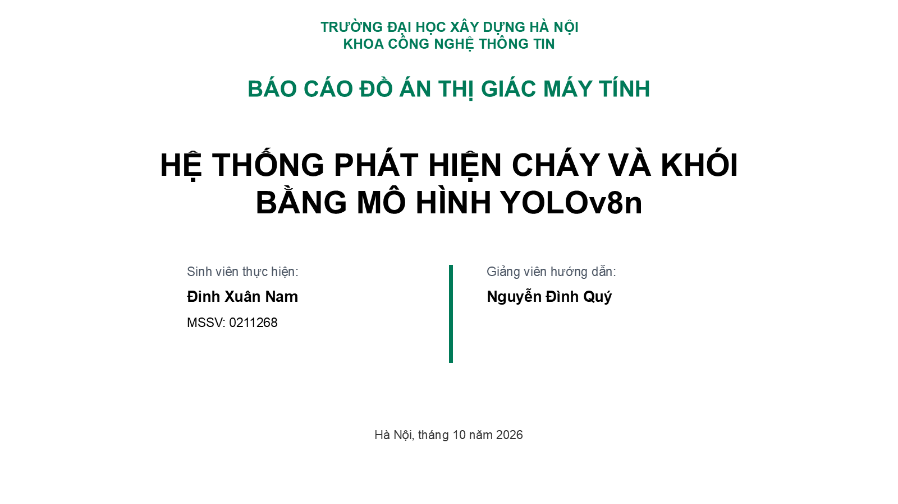

### Nội dung

TRƯỜNG ĐẠI HỌC XÂY DỰNG HÀ NỘI

KHOA CÔNG NGHỆ THÔNG TIN

BÁO CÁO ĐỒ ÁN THỊ GIÁC MÁY TÍNH

HỆ THỐNG PHÁT HIỆN CHÁY VÀ KHÓI

BẰNG MÔ HÌNH YOLOv8n

Sinh viên thực hiện:

Đinh Xuân Nam

MSSV: 0211268

Giảng viên hướng dẫn:

Nguyễn Đình Quý

Hà Nội, tháng 10 năm 2026

### Ghi chú thuyết trình

Thông tin bìa đối chiếu E:/DA_TGMT/report_revision/context.md và báo cáo hoàn thiện. Bố cục theo C:/Users/nofea/Downloads/Slide.pptx.

---

## Slide 02

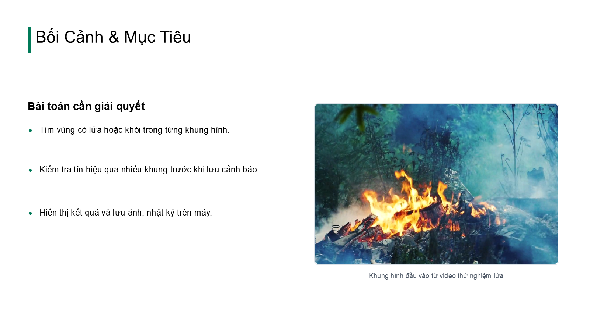

### Nội dung

Bối Cảnh & Mục Tiêu

Bài toán cần giải quyết

•

Tìm vùng có lửa hoặc khói trong từng khung hình.

•

Kiểm tra tín hiệu qua nhiều khung trước khi lưu cảnh báo.

•

Hiển thị kết quả và lưu ảnh, nhật ký trên máy.

Khung hình đầu vào từ video thử nghiệm lửa

### Ghi chú thuyết trình

Ảnh: E:/DA_TGMT/DATA/results/video_input_preview/video_chay.jpg. Phạm vi chương trình theo fire_detection/main.py, pipeline.py.

---

## Slide 03

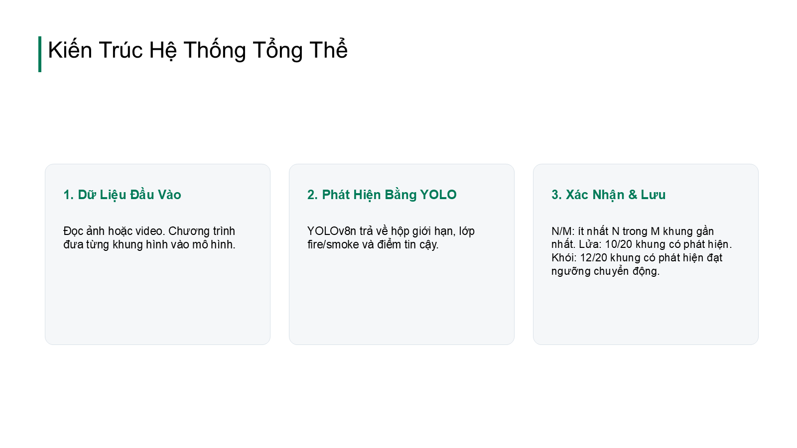

### Nội dung

Kiến Trúc Hệ Thống Tổng Thể

1. Dữ Liệu Đầu Vào

Đọc ảnh hoặc video. Chương trình đưa từng khung hình vào mô hình.

2. Phát Hiện Bằng YOLO

YOLOv8n trả về hộp giới hạn, lớp fire/smoke và điểm tin cậy.

3. Xác Nhận & Lưu

N/M: ít nhất N trong M khung gần nhất. Lửa: 10/20 khung có phát hiện. Khói: 12/20 khung có phát hiện đạt ngưỡng chuyển động.

### Ghi chú thuyết trình

N/M nghĩa là ít nhất N trong M khung gần nhất, không bắt buộc liên tiếp. Lửa dùng tín hiệu YOLO 10/20; khói dùng tín hiệu đã qua ngưỡng chuyển động 12/20. Nguồn: E:/DA_TGMT/fire_detection/pipeline.py và config.yaml.

---

## Slide 04

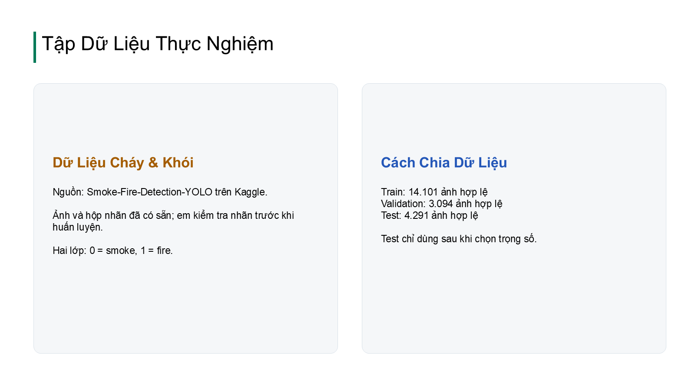

### Nội dung

Tập Dữ Liệu Thực Nghiệm

Dữ Liệu Cháy & Khói

Nguồn: Smoke-Fire-Detection-YOLO trên Kaggle.

Ảnh và hộp nhãn đã có sẵn; em kiểm tra nhãn trước khi huấn luyện.

Hai lớp: 0 = smoke, 1 = fire.

Cách Chia Dữ Liệu

Train: 14.101 ảnh hợp lệ

Validation: 3.094 ảnh hợp lệ

Test: 4.291 ảnh hợp lệ

Test chỉ dùng sau khi chọn trọng số.

### Ghi chú thuyết trình

Bộ dữ liệu sayedgamal99/smoke-fire-detection-yolo. Số ảnh hợp lệ theo E:/DA_TGMT/report_revision/context.md và hướng dẫn bảo vệ. data.yaml: E:/DA_TGMT/DATA/training/train_official_v2/fire_smoke_data.yaml.

---

## Slide 05

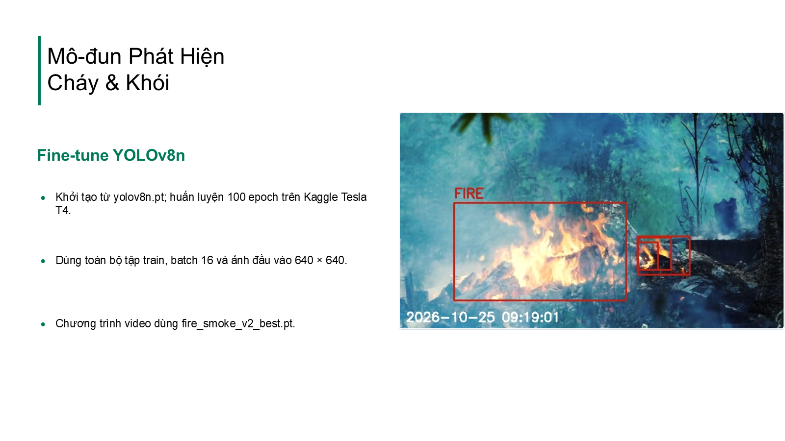

### Nội dung

Mô-đun Phát Hiện

Cháy & Khói

Fine-tune YOLOv8n

•

Khởi tạo từ yolov8n.pt; huấn luyện 100 epoch trên Kaggle Tesla T4.

•

Dùng toàn bộ tập train, batch 16 và ảnh đầu vào 640 × 640.

•

Chương trình video dùng fire_smoke_v2_best.pt.

### Ghi chú thuyết trình

Cấu hình train: E:/DA_TGMT/DATA/training/train_official_v2/fire_smoke_runs/train_official_v2/args.yaml. Ảnh: E:/DA_TGMT/DATA/results/presentation_simple/video_chay/images/alert_fire_20261025_091901_f000099.jpg.

---

## Slide 06

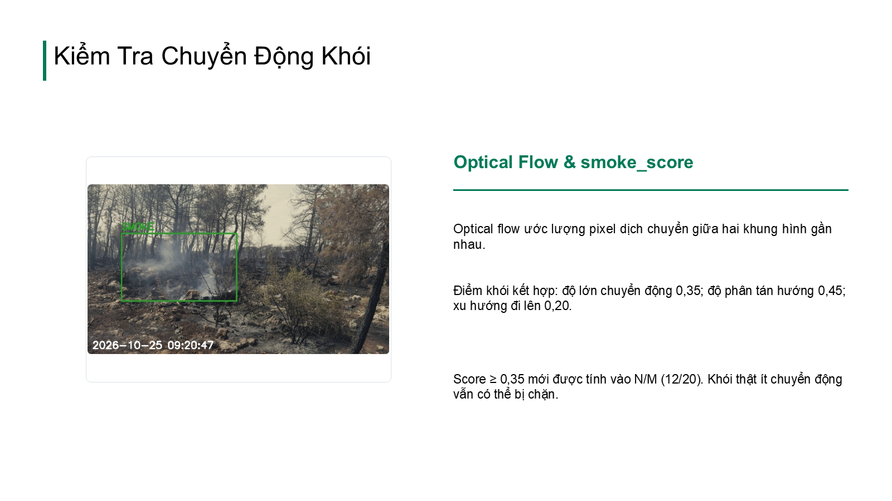

### Nội dung

Kiểm Tra Chuyển Động Khói

Optical Flow & smoke_score

Optical flow ước lượng pixel dịch chuyển giữa hai khung hình gần nhau.

Điểm khói kết hợp: độ lớn chuyển động 0,35; độ phân tán hướng 0,45; xu hướng đi lên 0,20.

Score ≥ 0,35 mới được tính vào N/M (12/20). Khói thật ít chuyển động vẫn có thể bị chặn.

### Ghi chú thuyết trình

Ảnh: E:/DA_TGMT/DATA/results/presentation_simple/video_khoi/images/alert_smoke_20261025_092047_f000128.jpg. Công thức và ngưỡng đối chiếu fire_detection/pipeline.py, config.yaml.

---

## Slide 07

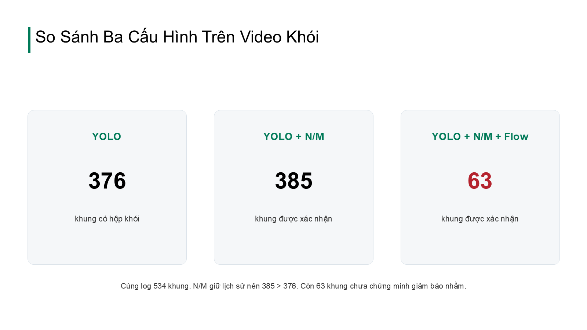

### Nội dung

So Sánh Ba Cấu Hình Trên Video Khói

YOLO

376

khung có hộp khói

YOLO + N/M

385

khung được xác nhận

YOLO + N/M + Flow

63

khung được xác nhận

Cùng log 534 khung. N/M giữ lịch sử nên 385 > 376. Còn 63 khung chưa chứng minh giảm báo nhầm.

### Ghi chú thuyết trình

Bộ nhớ N/M có thể duy trì xác nhận khi khung hiện tại không có hộp khói. 63 khung xác nhận chưa cho biết bộ lọc loại được bao nhiêu báo nhầm hoặc chặn bao nhiêu khói thật. Hai video sạch đã không báo ngay từ YOLO. Nguồn: DATA/results/main_v2_conf025_side640/ablation_saved_observations/comparison.json.

---

## Slide 08

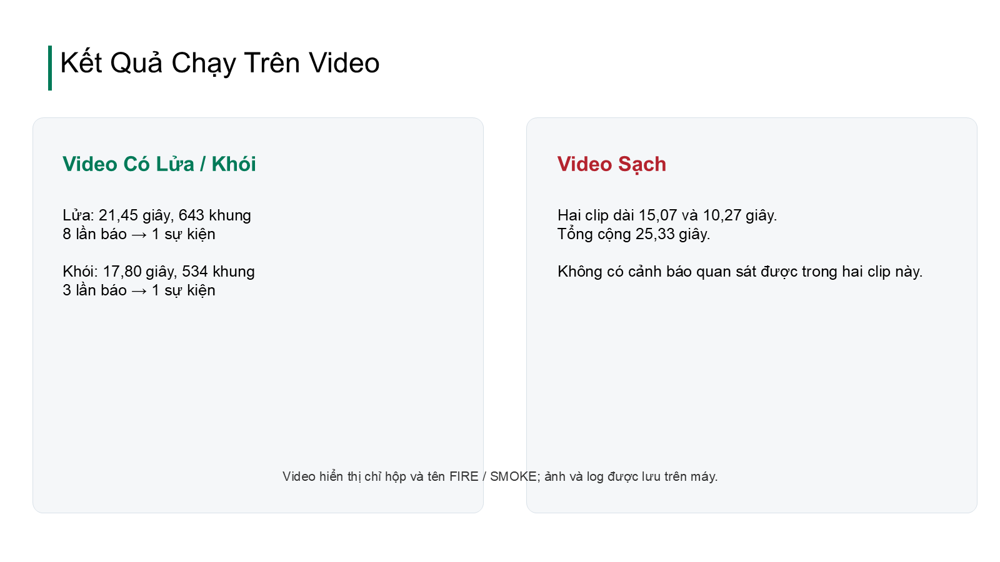

### Nội dung

Kết Quả Chạy Trên Video

Video Có Lửa / Khói

Lửa: 21,45 giây, 643 khung

8 lần báo → 1 sự kiện

Khói: 17,80 giây, 534 khung

3 lần báo → 1 sự kiện

Video Sạch

Hai clip dài 15,07 và 10,27 giây.

Tổng cộng 25,33 giây.

Không có cảnh báo quan sát được trong hai clip này.

Video hiển thị chỉ hộp và tên FIRE / SMOKE; ảnh và log được lưu trên máy.

### Ghi chú thuyết trình

Nguồn: E:/DA_TGMT/DATA/results/presentation_simple/video_chay/summary.json, video_khoi/summary.json; video sạch từ E:/DA_TGMT/DATA/results/main_v2_conf025_side640. Video trình chiếu ở hai thư mục presentation_simple.

---

## Slide 09

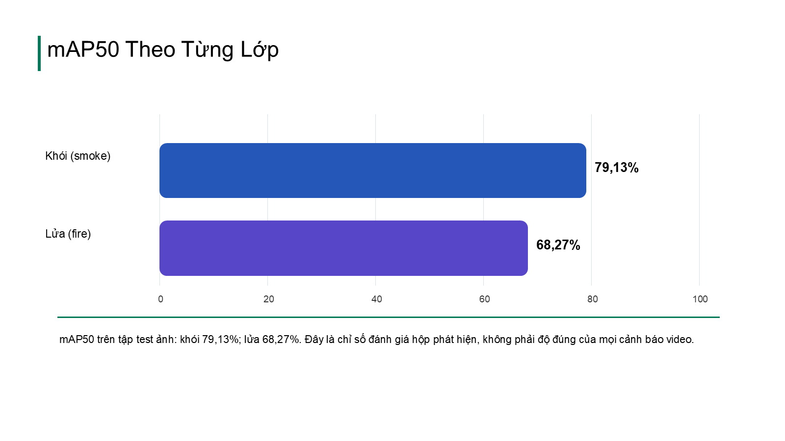

### Nội dung

mAP50 Theo Từng Lớp

0

20

40

60

80

100

Khói (smoke)

Lửa (fire)

79,13%

68,27%

mAP50 trên tập test ảnh: khói 79,13%; lửa 68,27%. Đây là chỉ số đánh giá hộp phát hiện, không phải độ đúng của mọi cảnh báo video.

### Ghi chú thuyết trình

Số test theo lớp từ E:/DA_TGMT/report_revision/context.md, trọng số fire_smoke_v2_best.pt và imgsz 640.

---

## Slide 10

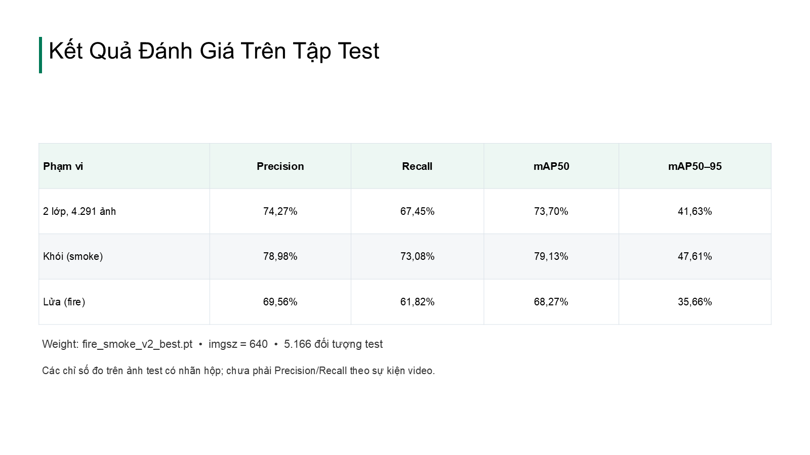

### Nội dung

Kết Quả Đánh Giá Trên Tập Test

| Phạm vi | Precision | Recall | mAP50 | mAP50–95 |
| --- | --- | --- | --- | --- |
| 2 lớp, 4.291 ảnh | 74,27% | 67,45% | 73,70% | 41,63% |
| Khói (smoke) | 78,98% | 73,08% | 79,13% | 47,61% |
| Lửa (fire) | 69,56% | 61,82% | 68,27% | 35,66% |

Weight: fire_smoke_v2_best.pt  •  imgsz = 640  •  5.166 đối tượng test

Các chỉ số đo trên ảnh test có nhãn hộp; chưa phải Precision/Recall theo sự kiện video.

### Ghi chú thuyết trình

Bảng từng lớp đối chiếu E:/DA_TGMT/report_revision/Bao_cao_chay_khoi_hoan_thien.docx, bảng kết quả test. Kết quả test trong E:/DA_TGMT/DATA/training/train_official_v2/runs/detect/val; tên thư mục val do Ultralytics đặt, lời gọi đánh giá dùng split=test.

---

## Slide 11

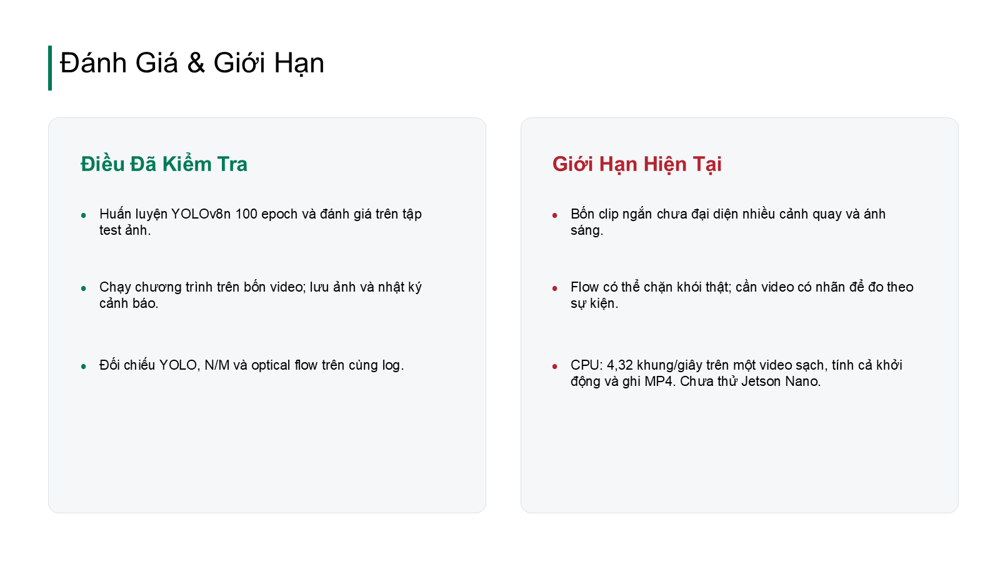

### Nội dung

Đánh Giá & Giới Hạn

Điều Đã Kiểm Tra

•

Huấn luyện YOLOv8n 100 epoch và đánh giá trên tập test ảnh.

•

Chạy chương trình trên bốn video; lưu ảnh và nhật ký cảnh báo.

•

Đối chiếu YOLO, N/M và optical flow trên cùng log.

Giới Hạn Hiện Tại

•

Bốn clip ngắn chưa đại diện nhiều cảnh quay và ánh sáng.

•

Flow có thể chặn khói thật; cần video có nhãn để đo theo sự kiện.

•

CPU: 4,32 khung/giây trên một video sạch, tính cả khởi động và ghi MP4. Chưa thử Jetson Nano.

### Ghi chú thuyết trình

Một lần chạy video_khong_chay2.mp4 trên CPU: 308 khung / 71,252 giây = 4,323 khung/giây. Thời gian toàn lệnh gồm khởi động Python/mô hình, giải mã, suy luận, hậu xử lý, ghi MP4 và kết quả. Chưa đo tốc độ ổn định trên nhiều video. Nguồn: E:/DA_TGMT/DATA/results/fps_measure_20261026/measurement.json.
